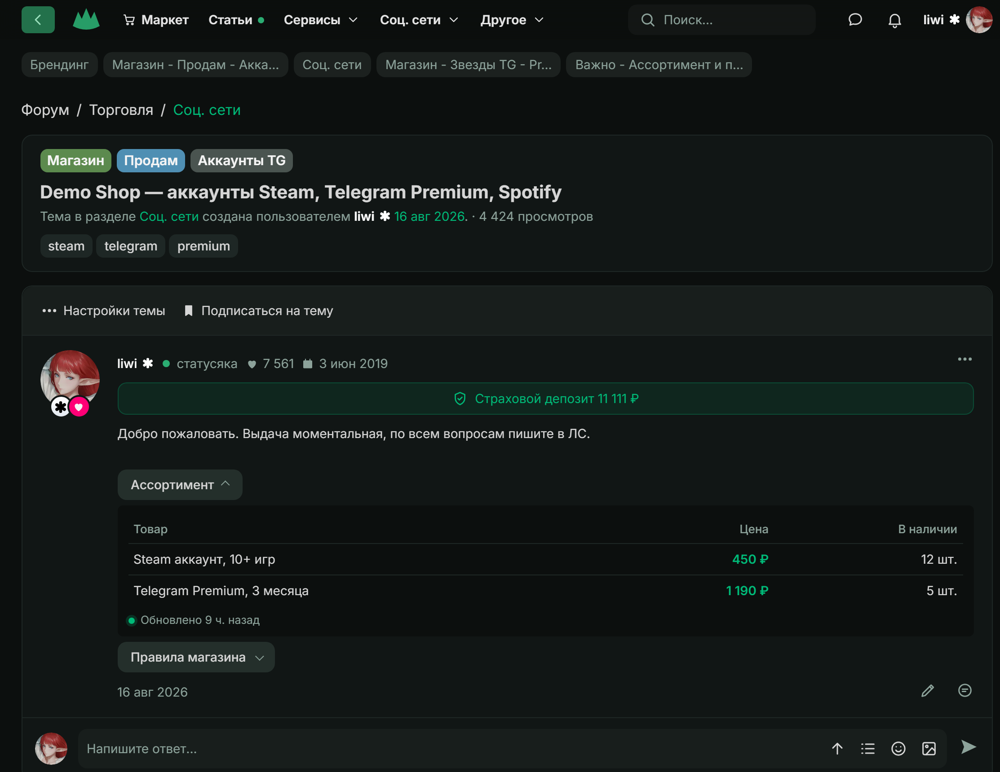
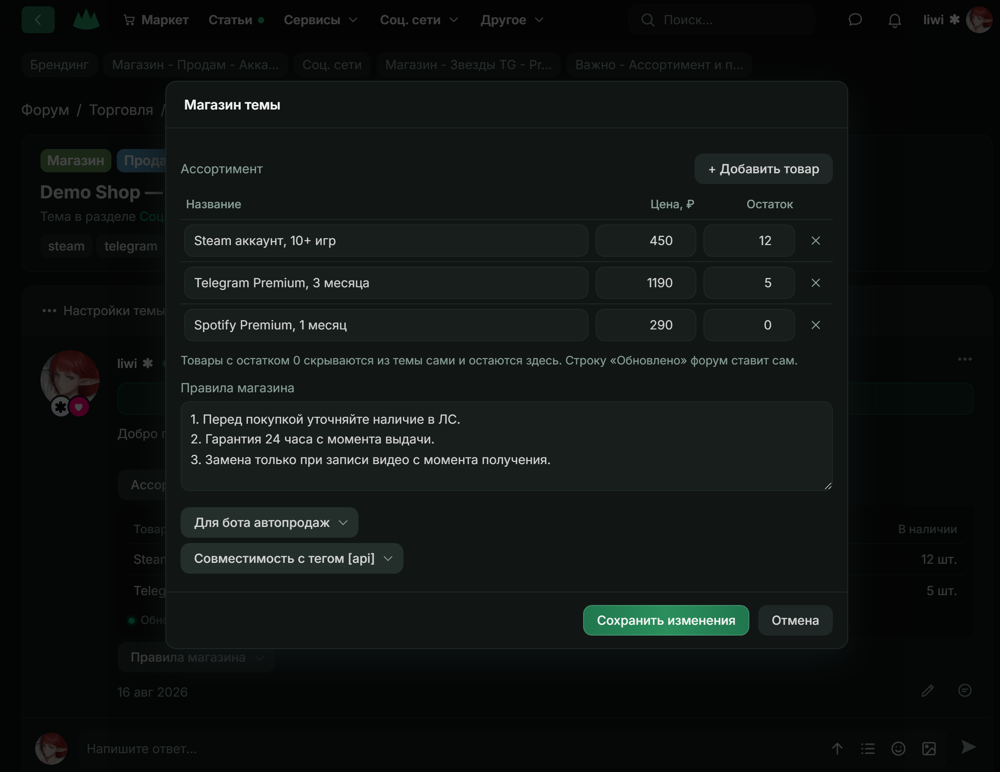

<h1 align="center">Lolzteam Shop</h1>

<p align="center">
  Прототип встроенного магазина темы для Lolzteam. Ассортимент и правила хранятся на форуме, а не на внешнем хостинге продавца.
</p>

<p align="center">
  <a href="https://github.com/liwidale/lolzteam-shop/actions/workflows/ci.yml"></a>
  
  <a href="LICENSE"></a>
</p>

<p align="center">
  
</p>

<p align="center"><sub>Тема магазина в прототипе. Остатки в таблице обновляются без перезагрузки страницы.</sub></p>

С 1 декабря магазины на форуме обязаны подгружать ассортимент через тег `[api]`. Для этого продавцу нужен свой хостинг без порта и проверки Cloudflare, файл в строгом формате и терпение на 15 минут кеша. Lolzteam Shop показывает другой путь: продавец ведёт ассортимент в таблице прямо в настройках темы, бот меняет остатки одним запросом к API форума, а тема обновляется сразу.

## Содержание

- [Установка](#установка)
- [Что вы получаете](#что-вы-получаете)
- [Начало работы](#начало-работы)
- [Бот автопродаж](#бот-автопродаж)
- [Безопасность](#безопасность)
- [Разработка](#разработка)
- [Как это работает](#как-это-работает)
- [Структура проекта](#структура-проекта)
- [Участие](#участие)
- [Лицензия](#лицензия)

## Установка

Нужен Node.js 18 или новее. У самого сервера нет зависимостей, пакеты из `devDependencies` нужны только для проверок.

```bash
git clone https://github.com/liwidale/lolzteam-shop.git
cd lolzteam-shop
npm start
```

## Что вы получаете

- **Ассортимент без хостинга.** Таблица «название / цена / остаток» и поле правил открываются из «Настройки темы → Магазин темы». Сервер, домен и nginx не нужны.
- **Мгновенное обновление.** Данные лежат в базе форума, поэтому кеш не нужен. У тех, кто смотрит тему, остатки меняются без перезагрузки страницы.
- **Рутину делает форум.** Товары с нулевым остатком скрываются из темы сами. Строку «Обновлено» тоже ставит форум.
- **API для ботов.** Бот работает с тем же токеном, что и с `api.lolz.team`. При продаже он отправляет один запрос.
- **Защита от затирания.** Если бот продал товар, пока продавец редактировал таблицу, сохранение не перезапишет остатки и попросит обновить страницу.
- **Совместимость с тегом `[api]`.** Форум сам отдаёт `assortment.txt`, `rules.txt` и `shop.json` в нынешнем формате, поэтому старый тег продолжает работать без чужого хостинга.
- **Интерфейс форума.** Шрифты, цвета и размеры сняты со страницы темы Lolzteam, окна повторяют «Редактирование сообщения».

<p align="center">
  
</p>

## Начало работы

1. Запустите сервер командой `npm start`.
2. Откройте http://localhost:8080. Как и на форуме, сайт работает по сессии, поэтому вы сразу вошли как автор демо-темы `liwi`.
3. Откройте «Настройки темы → Магазин темы», измените остаток и нажмите «Сохранить изменения». Таблица в теме обновится сразу.
4. Чтобы вставить магазин в сообщение, нажмите карандаш и затем зелёную кнопку магазина на панели редактора. Она добавит тег `[shop]`.

Данные сохраняются в `data/db.json`. Удалите этот файл, чтобы вернуться к демо-данным из `data/seed.json`.

## Бот автопродаж

Во втором окне терминала запустите бота. Он продаёт случайный товар раз в 3 секунды, и остатки в открытой теме тают на глазах.

```bash
npm run bot
```

Бот принимает токен, номер темы и адрес API: `node bot-example.js [токен] [id темы] [адрес API]`. Токены демо-пользователей лежат в `data/seed.json`: `demo-token-1` у автора темы, `demo-token-2` у другого пользователя, ему сервер ответит 403.

Запросы бота в формате API форума:

```bash
curl -X POST http://localhost:8080/api/threads/1/shop/items/steam10/sold -H "Authorization: Bearer demo-token-1" -d "qty=1"
curl -X PATCH http://localhost:8080/api/threads/1/shop/items/steam10 -H "Authorization: Bearer demo-token-1" -d "stock=20"
```

## Безопасность

- Управлять магазином и править сообщение может только автор темы. Чужой токен получает 403.
- Страница входит по cookie с флагами `HttpOnly` и `SameSite=Strict`. Изменения по сессии принимаются только с заголовком `X-Requested-With`, как `_xfToken` в XenForo.
- Токены сравниваются за постоянное время и не попадают в публичные ответы.
- Тело запроса ограничено 100 КБ, магазин 200 товарами, правила 5000 символами.

## Разработка

```bash
npm install
npm test
npm run lint
npm run format:check
```

Тесты поднимают сервер на порту `18181` с временной базой и проверяют витрину, формат `assortment.txt`, вход по сессии, защиту от CSRF, права автора, продажи и защиту от затирания. GitHub Actions запускает те же проверки на каждый push.

## Как это работает

Методы оформлены как продолжение публичного API форума: авторизация `Authorization: Bearer <токен>`, ошибки в виде `{"errors": [...]}`, тело запроса в JSON или формой. В прототипе они доступны по адресу `http://localhost:8080/api/...`, на форуме это был бы `https://api.lolz.team/...`.

| Запрос                                                | Что делает                                                                        |
| ----------------------------------------------------- | --------------------------------------------------------------------------------- |
| `GET /threads/{thread_id}/shop`                       | Публичная витрина, только товары в наличии                                        |
| `GET /threads/{thread_id}/shop/manage`                | Весь магазин автора, включая нулевые остатки                                      |
| `PUT /threads/{thread_id}/shop`                       | Сохраняет таблицу и правила разом, при устаревшем `base_update_date` отвечает 409 |
| `PATCH /threads/{thread_id}/shop/items/{item_id}`     | Меняет остаток, цену или название одного товара                                   |
| `POST /threads/{thread_id}/shop/items/{item_id}/sold` | Списывает `qty` при продаже, при нехватке отвечает 409                            |
| `GET /threads/{thread_id}/shop/events`                | Поток обновлений для открытой темы через SSE                                      |
| `GET /threads/{thread_id}/shop/assortment.txt`        | Текст для нынешнего тега `[api]`                                                  |
| `GET /threads/{thread_id}/shop/rules.txt`             | Правила для нынешнего тега `[api]`                                                |

Сейчас у API общий лимит 30 изменяющих запросов в минуту. Методам магазина стоит дать отдельный счётчик, как у `/batch`, чтобы бот с частыми продажами не упирался в общий лимит.

## Структура проекта

```
server.js             сервер: страницы, сессии, API магазина, SSE
bot-example.js        пример бота автопродаж
public/topic.html     тема, меню «Настройки темы», окна магазина и правки сообщения
public/style.css      стили по меркам страницы форума
data/seed.json        демо-данные: пользователи, тема, магазин
test/server.test.js   тесты API
```

## Участие

Issues и pull requests приветствуются. Перед отправкой изменений запустите `npm test`, `npm run lint` и `npm run format:check`. Новые маршруты повторяют формат API форума, тексты интерфейса и ошибок пишутся на русском.

## Лицензия

[MIT](LICENSE) © 2026 Liwidale

Lolzteam и XenForo принадлежат их владельцам. Проект не связан с администрацией Lolzteam и показывает идею, а не готовый модуль форума.

<p align="center"><sub>ゝ made by <a href="https://github.com/liwidale">liwidale</a></sub></p>
